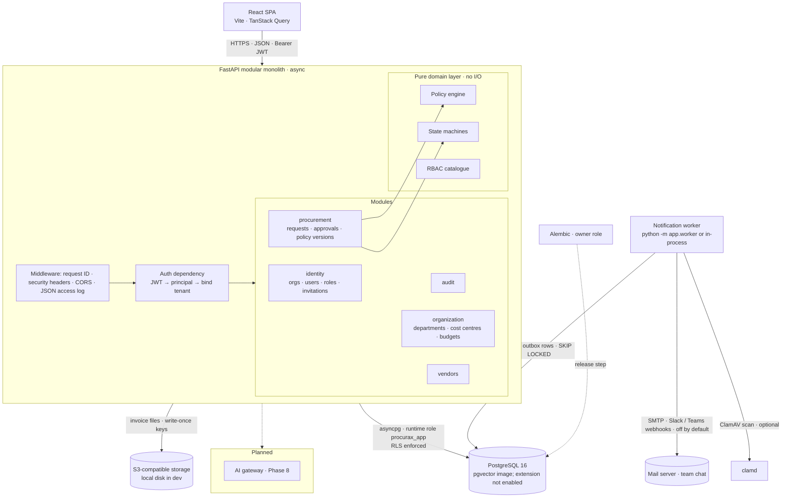
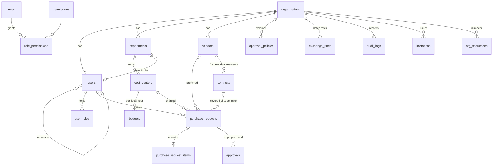

# System design — ProcuraX

Living document. Sections describe **what is built** unless marked *(planned)*. Build status
per stage is tracked in [`transformation_roadmap.md`](transformation_roadmap.md).

## 1. Business requirements

Replace e-mail, spreadsheet and stamp-chain procurement with one governed purchase-to-pay
workflow. Every purchasing decision must be policy-compliant, explainable and auditable, and
the platform must produce structured data for spend intelligence and AI.
See [`business_problem.md`](business_problem.md).

## 2. Functional requirements (current scope)

- Multi-tenant registration; users, roles and invitations; org structure (departments, cost
  centres); budgets per cost centre per fiscal year.
- Purchase requests with line items; deterministic policy evaluation; sequential approval
  chains; reject, cancel and reopen; resubmission rounds.
- Vendor master with onboarding status, risk, contract status and categories.
- Versioned approval policy with dry-run preview.
- Append-only audit trail; per-request timeline.

The full list, with status per item, is in [`product_spec.md`](product_spec.md).

## 3. Non-functional requirements

| Quality | Requirement | How it is met today |
|---|---|---|
| Isolation | No cross-tenant read or write, even with an application bug | App scoping + PostgreSQL RLS (FORCE), fail-closed |
| Integrity | No lost updates, overspend races or duplicate numbers | Row locks, budget re-check under lock, atomic sequence upsert, DB constraints |
| Auditability | Every state change traceable to an actor, rule and request | Audit entry in the same transaction; runtime role cannot UPDATE/DELETE audit rows |
| Explainability | Every routing/blocking decision cites rules | Policy evaluation snapshot stored on the request, with its policy version |
| Security | OWASP-aware defaults | See §9 |
| Operability | Health/readiness, structured logs, request IDs | Implemented; metrics and tracing planned (P19) |
| Performance | Measured, not assumed | A local `/health` smoke was measured; no authenticated API or database capacity claim. See P17. |

## 4. Architecture

### Why a modular monolith

A single deployable service with **strict module boundaries**. Each module owns its models,
schemas, service and router. Cross-module access goes through service functions, and the pure
domain layer has no framework or I/O imports.

It is not split into microservices because:
- one team, one release cadence;
- the workflow needs cross-entity transactions (request + approvals + budget lock + audit in
  one commit), which microservices would turn into sagas without any business benefit;
- the operational cost (service mesh, distributed tracing, per-service deploys) buys nothing
  at this scale.

Seams already exist for extraction later: the invoice/OCR pipeline and AI inference are the
first candidates, because they have different scaling profiles (CPU/GPU-bound, bursty) and can
be asynchronous. See ADR-001.

### Request lifecycle (one API call)

1. `RequestContextMiddleware` assigns or propagates `X-Request-ID` and adds security headers.
2. `get_principal` decodes the JWT, then **binds the tenant**: `session.info["org_id"]`. The
   SQLAlchemy `after_begin` hook runs `set_config('app.org_id', …, true)` at the start of every
   transaction.
3. Permission guard (`requires(Permission.X)`) returns 403 on failure.
4. The service loads rows with explicit `org_id` filters and a role-based visibility clause;
   mutations take `SELECT … FOR UPDATE`.
5. Pure domain functions decide (policy engine, state machine).
6. Changes and audit entries are committed in **one transaction**.
7. The response uses one error envelope `{error: {code, message, details}, request_id}`.

## 5. Component design

| Component | Responsibility | Key files |
|---|---|---|
| Policy engine | `evaluate(facts, policy) → PolicyEvaluation` (outcome, ordered steps, rule hits, budget check). Pure and deterministic. | `app/domain/policy/engine.py` |
| PR state machine | Legal transitions; raises `InvalidStateTransitionError` | `app/domain/workflow/purchase_request.py` |
| Procurement service | Facts assembly, submit, approve, reject, cancel, reopen, inbox, visibility | `app/modules/procurement/service.py` |
| Assignee resolution | Manager → falls back to department head; head requesting → own manager; procurement/finance → pool | `_resolve_assignee` |
| Budget service | Committed/pending derived live from requests; `find_budget(for_update=True)` | `app/modules/organization/service.py` |
| Audit | `record()` in the caller's transaction; `for_entity()` timeline | `app/modules/audit/service.py` |
| Numbering | `INSERT … ON CONFLICT DO UPDATE … RETURNING`, per tenant per year | `app/core/sequences.py` |

## 6. Data architecture

The ERD is centred on the tenant. Every business table carries `org_id` (FK →
`organizations`) with an index.

Conventions:
- **UUID primary keys**, generated app-side, so they are known before the insert and never
  guessable across tenants. Human-readable numbers (`PR-2026-000042`) are per-tenant sequences.
- **Money** is `NUMERIC(18,2)` plus a currency code. It travels as a decimal string in JSON
  and is never a float.
- **Status vocabularies** are CHECK constraints, not PostgreSQL ENUMs (ADR-006).
- **Soft delete** (`deleted_at`) on organisations, users, departments and vendors. Transactional
  records are never deleted; they are cancelled.
- **Timestamps** are `timestamptz`, set app-side (ADR-011). The audit log uses an identity
  `seq` for strict ordering.
- **Constraints** carry business invariants: positive quantities, non-negative amounts, one
  active policy per tenant (partial unique index), case-insensitive unique vendor name per
  tenant (functional index excluding soft-deleted rows), invoice registration number format
  `^T\d{13}$`, lower-case e-mails.
- **Indexes** follow the access paths: inbox (`org_id, status, approver_role` /
  `assigned_user_id`), lists (`org_id, status`, `org_id, requester_id, created_at`), vendor
  category search (GIN on `categories`, queried with `@>`).

Implemented tables *(P5–P13)*: `approval_delegations`, `vendor_quotes` (including award
attribution), `purchase_orders`, `purchase_order_items`, `goods_receipts` (linked to PO lines),
`invoices` (manual line metadata, JSONB line match evidence and finance review fields), `payments`
(approval record only; no transfer integration), and tenant-scoped versioned
`procurement_knowledge_documents`.

Notification tables *(gap-closure Phase 2)*: `notification_outbox` (events written in the same
transaction as the change), `notification_deliveries` (one row per external message, unique delivery
key), `notifications` (in-app), `notification_preferences` and `notification_channels` (tenant Slack /
Teams webhooks, URL encrypted). All five have forced RLS; the runtime role cannot delete from them
except to remove a channel.

Invoice files *(gap-closure Phase 3)*: `invoice_documents` holds the object key, SHA-256, size, MIME
type, page count, uploader, retain-until date, scan status and the invoice link. A trigger makes a file's
identity immutable, the link one-time, and linked rows undeletable (also for the owner role, except under
an explicit transaction-local purge flag used by the fictional demo reset); the runtime role has no
DELETE privilege.

Contracts, currencies and ledger *(gap-closure Phase 5)*: `contracts` (lifecycle, categories, dates,
value cap in its own currency, signed file in object storage), `purchase_requests.contract_id` and the rate
snapshot (`fx_rate`, `fx_rate_on`, `fx_source`, `base_amount`), `exchange_rates` (dated, per source),
`gl_account_mappings`, `journal_exports` (insert-only, file and SHA-256 kept) with
`invoices` / `payments.journal_export_id` markers, and `organizations.ledger_settings`. All tenant tables
have forced RLS.

Planned tables: invoice line items, `spend_transactions`, `ai_predictions`, `feedback`.

## 7. AI architecture *(offline baselines delivered; full AI pipeline planned)*

Current offline components are a synthetic-data TF-IDF/logistic regression spend classifier,
a robust log-MAD amount outlier baseline, a pairwise vendor ranker with synthetic evaluator, a
deterministic parser for labeled invoice text with an OCR-tolerant mode, a local Tesseract/PDF
OCR adapter (benchmarked end to end on synthetic renders), and BM25 retrieval over
tenant-versioned text sources plus versioned policy rules. The assistant returns active
threshold configuration and cited source excerpts. Sourcing awards persist the baseline
recommendation, the human decision and any override reason (`vendor_quotes.award_context`).
No AI result is connected to automatic approval or payment.

- An **AI gateway** module wraps every model call. It records inputs, output, confidence,
  latency, model version and the eventual human decision in `ai_predictions`. This is the
  basis for acceptance and override metrics and for drift detection.
- AI outputs enter the workflow only as **recommendations or signals**. The policy engine and
  match rules decide, and people approve (see product spec §5).
- *(Planned, gap-closure Phase 8.)* Semantic retrieval will use pgvector in the same PostgreSQL,
  under the same RLS, so tenant-aware retrieval is structural and not a filter someone could
  forget (ADR-002). Today the database runs the `pgvector/pgvector:pg16` **image only**: no
  migration creates the extension, no table has a vector column, and retrieval is BM25.
- The analytics assistant will generate SQL only against **read-only, RLS-bound views**,
  validate it with a parser allow-list, and run it as a read-only role with a statement
  timeout.

## 8. Integration architecture *(notifications built; the rest planned)*

| Integration | Pattern | Notes |
|---|---|---|
| ERP (journal) | Batch file export of balanced journal entries (CSV / JSON), imported by a person | **Built:** matched invoices and paid invoices, each exported once (ADR-018); account mapping per category / cost centre. Pushing to an ERP API, and PO / vendor master sync, are not built |
| Exchange rates | ECB euro reference rates (free, no key), off unless `PROCURAX_FX_ECB_ENABLED`; manual rates otherwise | **Built:** cross rates to the tenant's base currency, snapshotted on each request at submission (ADR-016). Parsed from a fixture in tests; not fetched live in CI |
| Identity provider | OIDC SSO | Replaces passwords for enterprise tenants |
| E-mail | SMTP from the outbox worker (Mailpit locally); off unless `PROCURAX_EMAIL_ENABLED` | **Built:** approval, escalation, delegation, rejection, PO, invoice-mismatch and payment events in the recipient's language. Invitation e-mails are not sent yet |
| Team chat | Slack / Microsoft Teams incoming webhooks per tenant; off unless `PROCURAX_WEBHOOKS_ENABLED` | **Built:** the tenant admin picks events; URL host allow-listed and encrypted at rest |
| Object storage | S3-compatible behind `ObjectStorage` (RustFS locally and in CI, AWS S3 or Cloudflare R2 in production; local disk for development) | **Built for invoice files:** uploads through the API (type, magic-byte, size and page checks), write-once keys (`If-None-Match: *`), downloads after a permission check via 60-second SigV4 presigned URLs or streamed with a hash re-check; optional ClamAV scan by the worker |
| Payment / accounting sandbox | Webhooks | Payment status back into the P2P record |
| NTA qualified-invoice registry | Official Web-API (needs an NTA application ID), cached 24 h, off by default | **Built:** registration status on the invoice date recorded on the match; disabled/unreachable falls back to the check digit + vendor master. Tested against a local mock only |
| Peppol / JP PINT e-invoices | Receive UBL 2.1 Invoice XML (`POST /einvoices`) | **Built:** mapped onto PO lines and matched like manual invoices; safe XML parsing. Sending over Peppol (access point) is out of scope ([einvoicing.md](einvoicing.md)) |

Idempotency: every notification delivery has a deterministic key (event + channel + recipient) with a
unique constraint, so replays insert nothing twice; the key is sent as the e-mail Message-ID and the
webhook `Idempotency-Key` header so receivers can deduplicate. Delivery is at-least-once (ADR-013). ERP
writes will follow the same outbox pattern.

## 9. Security architecture

| Control | Implementation |
|---|---|
| Authentication | Argon2id password hashes; optional TOTP second step; optional OpenID Connect SSO for existing users; uniform "invalid e-mail or password" plus a dummy-hash check against user enumeration ([security.md](security.md)) |
| Sessions | HS256 access JWT (15 min, in memory, with the session id) plus a rotating refresh token in an HttpOnly `SameSite=Strict` cookie; reuse detection; CSRF header + Origin check on the cookie endpoints; revocation on sign-out, deactivation and MFA reset (ADR-019) |
| Authorisation | Permission guards per endpoint plus row-level visibility clause; 404 for invisible rows |
| Tenant isolation | App scoping + RLS with `FORCE ROW LEVEL SECURITY`. The runtime role is neither owner nor superuser. The bypass is explicit (`system_session`) and used only for sign-in (password, MFA, SSO, refresh), invitation acceptance, worker sweeps and platform-admin tenant listing. |
| Least privilege (DB) | Runtime role: DML only; `audit_logs` INSERT/SELECT only; RBAC catalogue read-only; no access to `alembic_version` |
| Input validation | Pydantic schemas with bounds, patterns and enum types; DB CHECK constraints as the last line |
| Secrets | Env vars; startup refuses the default JWT secret in `prod`; `.env` ignored by git |
| Headers | `nosniff`, `X-Frame-Options: DENY`, `Referrer-Policy`, `Permissions-Policy`, COOP; CSP `default-src 'self'`; strict CORS allow-list (credentials only for explicit origins) |
| Invitations | 256-bit random tokens, stored as SHA-256, single use, 72 h expiry, revocable |
| Invoice files | Accepted only as PDF/PNG/JPEG/TIFF whose bytes match the extension, ≤ 18 MiB, PDFs 1–10 pages and unencrypted; stored under an application-generated tenant-prefixed key (never the uploaded name); SHA-256 recorded and re-checked on scan and on streamed download; infected or still-scanning files cannot be downloaded or block payment; immutable once stored (trigger) |
| Outbound webhooks | Tenant-supplied URLs must be https on an allow-listed Slack/Microsoft host (no credentials, default port), checked on save and again before every post (SSRF); stored encrypted (Fernet, key derived from `PROCURAX_DATA_ENCRYPTION_KEY`, rotation supported); never returned by the API |
| SQL injection | ORM / bound parameters everywhere. The only interpolated DDL identifier (the role name in the migration) is regex-validated. |
| Rate limiting | Failed sign-in, MFA, invitation and SSO attempts counted in PostgreSQL, shared by all replicas (ADR-021) |
| AI-specific *(planned)* | Prompt-injection isolation for retrieved text, tenant-aware retrieval via RLS, tool allow-list, read-only SQL role, output validation |

## 10. Multi-tenancy model (ADR-004)

Shared database, shared schema, `org_id` on every row. There are two independent layers:

1. **Application.** Every query filters on `principal.org_id`. Lookups by ID check `org_id`
   and return 404 on mismatch.
2. **Database.** The RLS policy on every tenant table:
   `org_id = NULLIF(current_setting('app.org_id', true), '')::uuid OR current_setting('app.rls_bypass', true) = 'on'`.
   The setting is transaction-local (`set_config(…, true)`) and re-applied at every
   transaction start, so it can't leak across pooled connections. With no setting, the
   predicate matches nothing, so the database **fails closed**.

Tested directly as the runtime role (`tests/api/test_database_controls.py`): unfiltered
queries return only the bound tenant's rows; cross-tenant inserts are rejected by `WITH CHECK`;
no tenant context returns zero rows. Tested through the API
(`tests/api/test_tenant_isolation.py`): requests, approvals, vendors, budgets, users,
departments, cost centres, audit logs, inbox, timelines and cross-tenant references.

## 11. Scalability *(design intent; nothing load-tested yet)*

- The API is stateless (JWT), so it scales horizontally behind a load balancer. Each instance
  holds an async connection pool.
- PostgreSQL first scales vertically, then gets read replicas for analytics and a PgBouncer
  pool in transaction mode. That is compatible with our design because tenant context is
  transaction-local.
- Tenant-leading composite indexes keep per-tenant queries selective as total volume grows.
  Partitioning `audit_logs` and future `spend_transactions` by time is the next lever.
- Heavy or bursty work moves to workers off the request path. Notification delivery already does
  (outbox + `python -m app.worker`, any number of instances); OCR, embeddings and batch scoring are next.

## 12. Reliability & failure handling

| Failure | Behaviour |
|---|---|
| Concurrent approvals of one request | Row lock serialises them. The second caller sees the new state and gets a 409 if its action is no longer valid. |
| Concurrent final approvals on one budget | Budget-row lock plus re-check. The later one is routed to finance with BUD-002. Tested; see note below. |
| Double submit / double click | Row lock + state machine means exactly one transition; the second gets a 409 |
| Unique violations (codes, names, budgets) | Caught at flush and returned as a clear 409 |
| DB unavailable | `/ready` returns 503 so the load balancer drains; `/health` stays up for liveness |
| Unhandled error | Logged with request ID; generic 500 envelope (no stack traces to clients) |
| Migration failure | Runs as a separate release step before new instances start; migrations are reversible and round-trip tested (CI also round-trips a populated database) |
| Notification worker crashes mid-batch | Its transaction rolls back; the claimed rows become claimable again (`FOR UPDATE SKIP LOCKED`). A message the receiver accepted before the crash may be sent twice (at-least-once); the delivery key lets receivers deduplicate |
| Mail server or webhook down | The delivery backs off exponentially (30 s doubling to 1 h, ±20 % jitter), then is dead-lettered after `PROCURAX_NOTIFICATION_MAX_ATTEMPTS`; an org admin sees dead letters and retries them. The business transaction is never affected |
| Business transaction fails | Its outbox row rolls back with it, so no notification describes a change that did not happen |
| Object storage unavailable at upload | The upload fails before any row is written (bytes first, metadata second), so no row points at a missing object; a failed commit can leave an orphaned object, never a dangling row |
| ClamAV down | Files stay `pending` (which blocks payment) and are retried with backoff; nothing is marked clean without a scan |

Note on the concurrency test: it drives two genuinely concurrent DB transactions. With the
lock removed, it failed in 1 of 3 runs (the race is timing-dependent), so it detects the bug
probabilistically, not on every run.

## 13. Observability

Implemented: one JSON log line per request (method, route template, status, duration, request
ID); request ID echoed in responses and stored on audit rows; `/health` (liveness) and `/ready`
(DB check).

Planned *(P19)*: Prometheus metrics (latency histograms per route, DB pool, queue depth, worker
failures, AI latency, tokens and confidence), Grafana dashboards, OpenTelemetry traces.

## 14. Deployment *(P4, platform to be chosen)*

- Static SPA on a CDN; API as the Docker image (`backend/Dockerfile`, multi-stage, non-root
  uid 10001, image health check); managed PostgreSQL; HTTPS everywhere.
- Release: `alembic upgrade head` (owner credentials) → start new API instances → `/ready`
  gate → shift traffic. Rollback is the previous image; schema changes follow
  expand/contract, so the previous image stays compatible.
- CI (`.github/workflows/ci.yml`): lint → types → migration round-trip and drift check → tests
  with coverage → generated-docs check → dependency audit → frontend type/lint/build/audit →
  image build.

## 15. Cost model *(P20)*

Parameterised per request, invoice, assistant query and 1,000 transactions. Inputs will be
measured resource usage (from P17/P19) multiplied by the chosen provider's list prices, which
are cited with their date. No numbers until then.

## 16. Technology choices

| Question | Choice | Why |
|---|---|---|
| Why PostgreSQL? | PostgreSQL 16 | Relational integrity for a financial workflow (FKs, CHECKs, transactions, row locks); RLS for tenant isolation; JSONB for policy snapshots; pgvector available for RAG in the same security boundary (image only today; embeddings planned in Phase 8); mature managed offerings |
| Why FastAPI? | FastAPI + Pydantic v2 + SQLAlchemy 2 async | Typed request/response contracts, generated OpenAPI, async I/O suits DB-bound work now and LLM calls later; the Python ecosystem matches the ML stack |
| Why Redis / an event queue? | **No Redis.** PostgreSQL is the queue: a transactional outbox claimed with `FOR UPDATE SKIP LOCKED` (ADR-013). | Exactly-once *enqueue* with the business change, retries and dead letters without another stateful service on free tiers. Revisit with measurements if queue volume or latency outgrows PostgreSQL. |
| Why a deterministic policy engine? | Pure Python rules, versioned config | Compliance controls must be reproducible, testable and explainable to auditors; an LLM is none of those |
| Why a ranking model for vendors *(planned)*? | Learning-to-rank vs a rule baseline | The task is ordering candidates by expected outcome from tabular history, which is what LTR is built for. An LLM adds cost and non-determinism without tabular signal. |
| Why RAG? | BM25 over policy rules and tenant-versioned plain-text documents; hybrid retrieval + reranker planned | Policy answers need traceable source text. Ingestion and extractive citations exist; semantic embeddings and representative retrieval evaluation remain future work |
| Why human approval? | Risk-tiered HITL | Financial commitments need accountable people; automation handles low risk only |

## 17. Architecture Decision Records

**ADR-001 Modular monolith over microservices.** *Context:* one team; the workflow needs
multi-entity transactions. *Decision:* a single service with module boundaries and a pure
domain layer. *Consequences:* simple deploys and ACID workflows. Extraction candidates
(document AI, inference) are identified; boundaries must be policed in code review.

**ADR-002 PostgreSQL as the single datastore, pgvector for vectors.** *Decision:* avoid a
separate vector DB. *Consequences:* one backup and security model, and RLS covers embeddings.
If vector scale outgrows it, revisit with measurements. *Status:* decided, not yet exercised. The
local, CI and stack databases use the pgvector image, but the extension is not created and no
embeddings exist until Phase 8.

**ADR-003 Async FastAPI + SQLAlchemy 2.** *Consequences:* high I/O concurrency. Lazy loading is
disallowed in async, so loads are explicit (`selectin` or column queries), and timestamps are
set app-side (ADR-011).

**ADR-004 Shared-schema multi-tenancy with RLS.** *Alternatives:* schema-per-tenant (migration
fan-out, pool fragmentation) and DB-per-tenant (cost, ops). *Decision:* shared schema, `org_id`
everywhere, RLS as defence-in-depth, a non-owner runtime role, and FORCE RLS for managed
platforms where the owner is not a superuser. *Consequences:* cheap tenants and uniform
migrations; the `system_session` bypass must stay narrow.

**ADR-005 Deterministic policy engine; AI never decides policy.** *Consequences:* every
decision is reproducible from (facts, policy version). The evaluation snapshot is stored on
the request. Adding a rule means code, a test and a catalogue entry.

**ADR-006 CHECK constraints instead of PostgreSQL ENUM types.** Adding a status is a one-line
migration with no type rewrite. The vocabulary is generated from the Python enums.

**ADR-007 Bearer JWT now, cookie-based refresh later.** Short-lived access token in
sessionStorage for the first public stage; P18 moves to an httpOnly refresh cookie with an
in-memory access token and adds revocation.

**ADR-008 Budget utilisation derived, not stored.** Committed and pending amounts are computed
from requests, so they cannot drift. Correctness under concurrency comes from locking the
budget row at final approval. Revisit with a ledger table when POs and invoices add actuals
(P6/P7).

**ADR-009 Resubmission creates a new approval round.** History is immutable and a rejected
chain is never overwritten. The current round is `submission_count`.

**ADR-010 Named approvers are authorised by the org structure.** A user assigned by reporting
line or department headship may act on that step even without the generic approver role.
Pool steps require the role. This prevents stuck workflows while keeping pools permissioned.

**ADR-011 App-side timestamps.** `created_at`/`updated_at` are set in Python so no implicit
refresh (I/O) is needed under asyncio. The audit log adds an identity `seq` because timestamps
can tie within one transaction.

**ADR-012 The API returns codes; the SPA owns the wording (English and Japanese).** *Context:* the
UI must work in Japanese, while the API's messages, rule sentences and audit summaries are English
and are also stored (policy snapshots, audit rows). *Decision:* keep the API language-neutral: stable
`error.code`, plus `error.details.reason` (and `field`) on business-rule refusals the UI must explain.
The SPA uses i18next with keys typed against the English messages, so a missing Japanese key fails the
build. In Japanese, rule messages are rebuilt from each hit's structured `evidence`, and audit entries
are described by their `action` code; English keeps the server's exact sentence. The user's choice is
stored in `users.locale` (NULL = follow the browser) and Japanese loads as a separate chunk.
*Consequences:* every new refusal that users see needs a reason code and two translations; a Vitest
test fails if the UI's rule labels differ from the generated rule catalogue. Stored English text (audit
summaries, old policy snapshots) is never rewritten.

**ADR-013 PostgreSQL is the notification queue (transactional outbox, no Redis).** *Context:*
notifications must never describe a change that rolled back, nor be lost for one that committed; the
deployment runs on free tiers where every extra stateful service costs money or availability.
*Decision:* events are rows in `notification_outbox`, inserted in the same transaction as the change. A
worker (`python -m app.worker`, or an interval loop inside the API on hosts without background workers,
or a cron `--once` while a free instance sleeps) claims due rows with `FOR UPDATE SKIP LOCKED`, fans them
out to in-app rows and external deliveries with unique delivery keys, and sends with exponential backoff
and a dead-letter state. *Alternatives:* Redis/RQ or a cloud queue (a second store to run and a
dual-write problem without an outbox anyway); `LISTEN/NOTIFY` (not durable). *Consequences:*
enqueue is atomic with the business change; delivery is at-least-once, so receivers get an idempotency
key; throughput is bounded by PostgreSQL, which is ample at this scale. Outbox and delivery rows are kept
(no retention job yet).

**ADR-014 Invoice files: object storage behind an interface, immutable records, scan before payment.**
*Context:* invoices are evidence (7-year retention under Japanese corporate tax law; the Electronic
Bookkeeping Act expects tamper resistance) and untrusted input. *Decision:* files go to S3-compatible
storage behind a two-method interface (local disk for development; production refuses local disk), with
write-once keys. The database row records the SHA-256 and becomes immutable through a trigger, and the
invoice link is one-time. ClamAV runs in the worker, not the request; an invoice with an infected,
still-pending or (unless explicitly allowed) unscanned file cannot be requested for or approved for
payment. *Alternatives:* files in PostgreSQL (`bytea`, simplest but bloats backups and the free tier's
storage); presigned direct uploads (less API load, but validation would then happen after the bytes are
stored). MinIO was the intended local/CI stand-in, but its community container images are no longer
published; RustFS (Apache-2.0, S3- and MinIO-compatible) is used and was checked for conditional writes
and presigned URLs. *Consequences:* evidence cannot be swapped silently; uploads pass through the API
(18 MiB cap); no automatic deletion at the end of retention yet (bucket lifecycle or object lock is the
production control).

**ADR-015 Japanese compliance data comes from official sources, never decides alone, and fails safe.**
*Context:* a registration number's check digit does not prove registration; e-invoices arrive as Peppol
UBL. *Decision:* the NTA registry is read only through its official Web-API (no scraping), cached with a
fetch time, and treated as evidence: an issuer not active on the invoice date turns the match into a
finance exception, a human decides. When the API is off or down, the previous checks apply and the match
records why. UBL invoices are converted into the existing invoice input and run through the same
deterministic match; no separate path can approve them. *Consequences:* no new way to auto-approve
anything; one more external dependency behind a flag; full JP PINT Schematron validation is left to a
certified access point.

**ADR-016 Multi-currency by snapshot: convert once at submission, decide in the base currency.**
*Context:* VAL-004 used to block every request outside the tenant's currency; thresholds, budgets and
analytics are all in the base currency. *Decision:* tenants keep dated rates (`exchange_rates`: manual, or
ECB euro reference rates behind `PROCURAX_FX_ECB_ENABLED`; on the same day a manual rate wins). At
submission the latest rate on or before the tenant's local date is copied onto the request (`fx_rate`,
`fx_rate_on`, `fx_source`) with `base_amount`; policy, budget checks and recheck, contract caps and
analytics use `base_amount`. VAL-004 now blocks only when no rate exists. POs, invoices and payments stay
in the transaction currency. *Alternatives:* convert at read time (results would drift when rates change,
and an approval could no longer be reproduced); a live rate API on every request (an external call in the
approval path). *Consequences:* a decision is reproducible from the request row alone; correcting a rate
does not touch submitted requests; a request resubmitted later takes the new rate. Revaluation and
realised FX gains/losses are the ERP's job.

**ADR-017 Contracts are records with a lifecycle; the covering contract is snapshotted on the request.**
*Context:* off-contract buying was judged from a single `vendors.contract_status` field, with no dates,
categories or value cap. *Decision:* a `contracts` table (draft → active → expired / terminated through a
pure state machine; expiry by the worker's sweep, not a person). The policy fact "vendor has an active
contract" comes from an active contract covering the vendor, category and date; the old vendor field
remains the fallback only for vendors with no contract records. At submission the covering contract is
written to `purchase_requests.contract_id`, and the cap check (CON-001, route to procurement) sums
`base_amount` of requests in approval or approved under that contract. *Alternatives:* derive coverage at
query time from dates (cap usage would shift when a contract is edited or a second one starts).
*Consequences:* cap usage is explainable per request; caps in a currency without a rate route to
procurement instead of passing silently; reminders 30 days before the end go through the outbox once
(`expiry_reminded_at`).

**ADR-018 ERP integration starts as a once-only journal file, not an API push.**
*Context:* every ERP has its own posting API and approval rules; finance needs entries it can review before
posting. *Decision:* ProcuraX builds balanced journal entries (invoice: expense + input tax / payables;
payment after the bank file: payables / bank) from tenant ledger settings and category / cost-centre
mappings, as CSV or JSON. A batch locks the organisation row and the included documents (`FOR UPDATE`),
marks them with the batch id and stores the file with its SHA-256 in `journal_exports` (insert-only for
the runtime role), so a document is never exported twice and a file can be downloaded again unchanged.
*Alternatives:* push to an ERP API through the outbox (vendor-specific and needs credentials; possible
later on the same markers); files in object storage (bounded batches of at most 2,000 entries keep the
row small). *Consequences:* a human imports and posts; nothing in ProcuraX writes to a ledger.

**ADR-019 Sessions: short in-memory access token, rotating HttpOnly refresh cookie, CSRF by header.**
*Context:* the 60-minute access token sat in `sessionStorage`, readable by any script on the page, with no
way to revoke it. *Decision:* access tokens live 15 minutes in memory and carry the session id; a 256-bit
refresh token in an HttpOnly, `SameSite=Strict` cookie scoped to `/api/v1/auth` renews them and is rotated on
every use (hash stored, families of tokens, reuse after a 30-second grace revokes the family). The two
cookie endpoints require an `X-CSRF-Token` (HMAC of the session id, returned in the JSON body) and an allowed
`Origin`. The SPA and API share a site in every topology (Vite proxy, nginx, Netlify proxy to Render).
*Alternatives:* tokens in `localStorage` (readable by XSS, no revocation); server sessions only (a lookup
per request anyway, but no stateless access path for workers); a cross-site cookie with `SameSite=None`
(blocked by Safari's third-party-cookie rules). *Consequences:* signing out, deactivation and an MFA reset
take effect at the next request; a reload costs one refresh call; the Netlify proxy must be verified after
deployment.

**ADR-020 MFA is local TOTP; SSO is OpenID Connect for existing users only.** *Context:* enterprise tenants
expect MFA and SSO; ProcuraX is not an identity provider. *Decision:* RFC 6238 TOTP implemented in the pure
domain (no dependency, RFC test vectors), secrets encrypted with the data key, single-use recovery codes
stored as peppered HMACs, admin reset with sign-out. OIDC authorization code flow with PKCE against one
configured provider; the ID token is verified against the provider's JWKS; only an existing active user with
a verified matching e-mail signs in, and the IdP's own MFA applies to SSO sign-ins. *Alternatives:* WebAuthn
(stronger, more UI and browser work; next step); SAML (heavier, needed by some enterprises); just-in-time
provisioning from SSO (would bypass the invitation and role assignment). *Consequences:* no accounts appear
from an IdP; MFA is opt-in per user (organisation enforcement is open); tested against a local provider
stand-in only until a real tenant is available.

**ADR-021 Brute-force counters live in PostgreSQL.** *Context:* the failed-login throttle was in-process,
so each replica (and each restart) had its own count. *Decision:* a small `auth_throttle` table of hashed
keys and time buckets, written with an upsert and pruned as it goes; limits per address + account, per
address and per account. *Alternatives:* Redis (another service, ADR-013 again); the platform's edge rate
limiting (not available on the free tiers; can be added in front). *Consequences:* one extra write per
failed attempt, none for successful ones; counts survive restarts and are shared by replicas.
